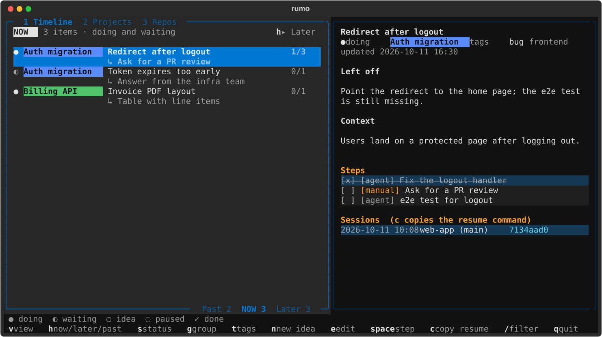

# rumo

**Your work, past, now and later.** rumo is a local, file-based organizer for a developer's own
work. Every piece of work is a Markdown file on your machine. Run `rumo` to see it all as a
Timeline, and let your AI agent sessions keep it up to date while you work.



- **Now**: what you are doing or waiting on, with the next step of each item.
- **Past**: what you finished in the last two weeks (answers "what did I do?" for a standup).
- **Later**: ideas and paused work, so nothing you meant to do gets lost.

Items can belong to a **group** (a project or initiative), shown as a label with its name on its
color; color in rumo only ever means the group. One item is one line, plus its next step. rumo shows
one horizon at a time (`h` steps Now, Later, Past), named in a banner atop the list, in three views: the **Timeline**,
**Projects** (one block per group) and **Repos** (one block per repository of the item's latest
agent session). The interface is in English; the content (titles, notes, steps) is in your own
language.

Nothing leaves your machine. There is no server, no database and no sync with Jira or ClickUp
(ask your agent to update those if you want).

## Install

**1. The `rumo` command** (pick one):

```bash
uv tool install rumo-cli            # macOS, Linux, Windows (https://docs.astral.sh/uv/)
pipx install rumo-cli               # macOS, Linux, Windows
brew install pedrobuzzi/tap/rumo    # macOS, Linux
```

Then run `rumo`. The first run creates `~/rumo/` for your items and a config file with your
system language.

**2. Your AI agent** (optional, but this is where rumo shines):

- **Claude Code**, full experience (the agent keeps linked items up to date):

  ```
  /plugin marketplace add pedrobuzzi/rumo
  /plugin install rumo@rumo
  ```

- **Codex, Gemini CLI, Cursor, GitHub Copilot and other agents** that read `SKILL.md` files,
  simple mode (create items and ideas, list and search them; no automatic updates):

  ```bash
  npx skills add pedrobuzzi/rumo
  ```

**Update**: `uv tool upgrade rumo-cli` (or `pipx upgrade rumo-cli`, `brew upgrade rumo`), and
`/plugin marketplace update rumo` in Claude Code, then `/reload-plugins` in sessions already open.
To get new plugin versions on their own, turn on auto-update for the `rumo` marketplace in `/plugin`
(Marketplaces tab); the `rumo` command updates with your package manager.

**Uninstall**: `/plugin uninstall rumo@rumo`, then `uv tool uninstall rumo-cli` (or
`pipx uninstall rumo-cli`, `brew uninstall rumo`). Your items in `~/rumo/` are never touched.

## Use

**In the terminal**: `rumo` opens the Timeline.

| Key | Action |
|---|---|
| ↑ ↓ | move through the list |
| Tab | switch between the list, steps and sessions |
| `v` | next view: Timeline, Projects, Repos (`1` `2` `3` go straight to one; rumo remembers it) |
| `h` | next horizon: Now, then Later, then Past, then Now again |
| `s` | change status (1-5 picks directly) |
| `g` | set the group or create one; inside, `r` renames, `c` recolors and `d` deletes the highlighted group (its items stay) |
| `t` | toggle tags |
| `n` | capture a new idea |
| `e` | open the item in `$EDITOR` |
| `a` | add a step to the selected item, after its open steps (below the highlighted one when the steps have focus); in the dialog, Tab switches `[agent]` and `[manual]` |
| Enter, shift+↑ ↓, `d`, space | with the steps focused: edit, move, delete (asks first) or check the highlighted step; Esc goes back |
| `x` | hide or show the done steps of every item (rumo remembers it) |
| `c` | copy the command that resumes the selected agent session |
| `/` | filter by title, tag, group or text (Esc clears) |
| `q` | quit |

**In an agent session**: type `/rumo` for a menu that fits the moment, or go straight to:

| Command | What it does |
|---|---|
| `/rumo new` | Track this session's work as an item. Looks for a similar idea first and offers to promote it. |
| `/rumo idea <text>` | Note something for later without leaving the topic. |
| `/rumo link [item]` | Continue an existing item in this session. |
| `/rumo now` | List what is in progress, with the next step of each. |
| `/rumo find <text>` | Search past, current and future items. |
| `/rumo status` | Show where you left off on the linked item. |
| `/rumo step <text>` | Add a step to the linked item, or to the item it belongs to when none is linked. |
| `/rumo park [reason]` | Pause the item with an accurate "Left off" and stop updating it here. |
| `/rumo done` | Finish the item (checks the steps, asks first). |
| `/rumo unlink` | Stop updating the item from this session. |

`link`, `status`, `park` and `unlink` need Claude Code with the plugin, because they rely on
its session id and hook. Other agents get the rest.

When you create an item or an idea, the agent checks whether it belongs to an existing group. If
other ungrouped items look like the same initiative, it suggests a new group (name and color) and
applies it only if you agree.

Steps are the heart of an item: while a session is linked, the agent checks off what got done, adds
what came up and keeps the next action as the first open step, after every response in which work
happened. If a turn did work and no linked item changed, the plugin reminds the agent before the turn
ends. Open steps are never deleted unless you ask, so half-done work stays in Now. One session can
follow several topics: when you start something no linked item covers, the agent asks once whether to
track it as a new item, add it as a step, or leave it out. Left off is one line and Context at most
three. `/clear` starts a new, unlinked session; `claude --resume <id>` picks the old one up again.

You can add, edit, move, check and delete steps in the Timeline too. On your next message, a linked
session is told which steps changed since its last answer, so it neither redoes nor re-adds them, and
it starts none of them unless you ask. When the agent finishes a step and more remain, it ends with
the next one: an offer to start it, or a note that it is yours.

In a session without an item, the agent learns at the start what is in progress in that repository
(up to three items, with their next step), so it can answer "what is left?"; `rumo now` lists
everything in progress. Once that session edits files, the agent asks whether to track it. The first
time it also asks whether to keep asking in future sessions (`ask_to_track` in the config). If you
say no, it reminds you that the option exists every 15 days or 15 sessions.

## Item format

```markdown
---
title: Redirect after logout
status: doing
group: auth
tags: [bug, frontend]
created: 2026-10-11 10:08
updated: 2026-10-11 16:30
---

## Left off
Point the redirect to the home page; the e2e test is still missing.

## Context
Users land on a protected page after logging out.

## Steps
- [x] [agent] Fix the logout handler
- [ ] [manual] Ask for a PR review
- [ ] [agent] e2e test for logout

## Sessions
- 2026-10-11 10:08 | web-app (main) | 7134aad0-4ba6-4583-9503-c08e98d28270 | /Users/you/repo/web-app
```

- Statuses: `idea`, `doing`, `waiting`, `paused`, `done`. `done: <date>` is set when an item is finished.
- Steps are `[agent]` (the AI can do it) or `[manual]` (you or someone else does it).
- An idea can be just the frontmatter; it grows when you start working on it.
- A session line ending in `| closed` no longer updates the item.

## Config

`config.toml` lives in `~/.config/rumo/` on macOS and Linux (or `$XDG_CONFIG_HOME/rumo/`) and in
`%APPDATA%\rumo\` on Windows. `rumo index` prints its path.

```toml
folder = "~/rumo"
language = "pt-BR"     # language of the content the agent writes; defaults to your system language
tags = ["bug", "feature", "refactor", "research", "spike", "review",
        "infra", "deploy", "meeting", "docs", "support", "tech-debt"]
ask_to_track = true    # offer rumo in agent sessions without an item; unset until you first answer

[groups.auth]
name = "Auth migration"
color = "blue"         # blue, green, yellow, orange, red, magenta, purple, cyan
```

Groups appear in the order of this file in every view. The last view, and when the agent last
asked about tracking, are remembered in `state.json`, next to `config.toml`.

`RUMO_DIR` and `RUMO_CONFIG` override the folder and the config path.

## Contributing

See [CONTRIBUTING.md](CONTRIBUTING.md) for the layout, tests, trying the plugin locally and how
releases work.

## License

[MIT](LICENSE)
